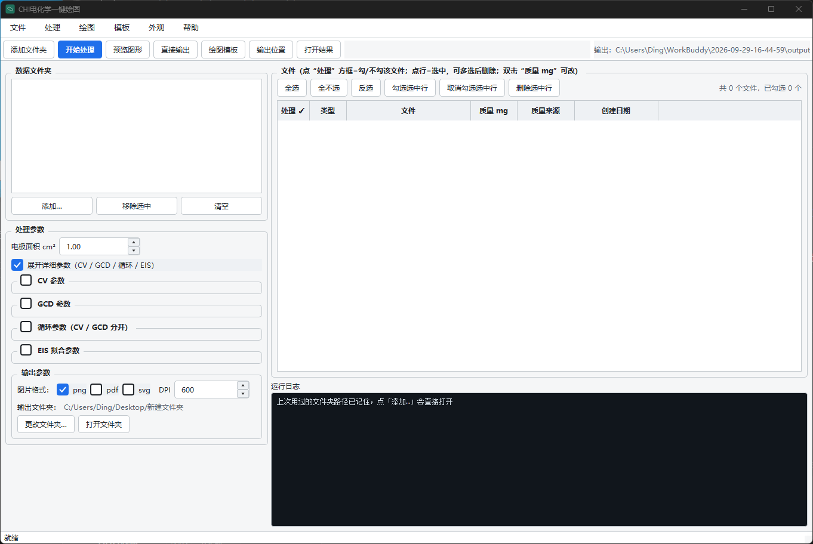

# ec-lab · CHI660 电化学数据批处理

一句话定位：把 CHI660F 电化学工作站导出的 CV / GCD / EIS 原始 txt 批量读进来，
算比电容、库伦效率、能量密度，做 EIS 等效电路拟合，出论文级图，最后一键导出 Excel。

> **English**: ec-lab is a desktop tool (Python + PySide6 + matplotlib) for
> batch-processing CHI660F electrochemical data. It parses raw CV / GCD / EIS
> exports, computes specific capacitance, Coulombic efficiency and energy
> density, fits equivalent circuits for EIS, renders publication-quality
> figures (600 dpi, locked axis ranges, real super/subscripts) and exports the
> results to Excel. Python 3.12+ required. MIT licensed.



## 功能

- **CV 批量解析**：识别段结构，默认取第 2、3 段（换向后的稳定段），自动算比电容 F/g，支持多扫速叠加对比
- **GCD 批量解析**：取第 2、3 段算放电时间、IR drop、比电容、库伦效率、能量密度
- **EIS 解析与拟合**：读阻抗谱，自动在 W / Wo / Ws 三种等效电路里择优（按 R²），给出各元件参数与拟合曲线
- **循环稳定性**：几千圈的长序列自动切圈、按步长抽点绘图，曲线不糊不断
- **论文级出图**：600 dpi、坐标轴范围可锁定、中英文混排上下标用 matplotlib mathtext 真上下标，不是假的字符拼接
- **六类图各自独立样式**：CV 叠加图 / CV 比电容 / GCD 曲线 / GCD 比电容 / EIS / 循环稳定性，每类的字号、线宽、颜色、图例、坐标轴都能单独存
- **Excel 导出**：结果表按图类别分工作表导出，含汇总
- **配置保险箱**：写回设置前自动备份（保留最近 10 份）、写入用原子替换、配置损坏自动从备份恢复，手改坏了也不会丢设置
- **一键体检**：`python doctor.py` 检查 Python 版本、依赖包、绘图字体、数据路径、写入权限，还会跑一遍算法自检
- **质量必须先登记**：每个样品的活性物质质量必须逐个填真实值，未登记的样品会被**跳过并提示**，程序绝不拿兜底值蒙一个结果

## 安装

需要 **Python 3.12 或更新**（numpy 2.x / pandas 3.x 的要求）。

```bash
# 1. 取代码（把下面 URL 里的 <your-name> 换成自己的 GitHub 账号；
#    也可以直接在网页上点 Code → Download ZIP 解压）
git clone https://github.com/<your-name>/ec-lab.git
cd ec-lab

# 2. 建虚拟环境（Windows）
python -m venv .venv
.venv\Scripts\activate

# 3. 装依赖
pip install -r requirements.txt
```

macOS / Linux 把第 2 步换成 `python3 -m venv .venv && source .venv/bin/activate`。
界面基于 PySide6，Windows 上体验最好；Linux 需要系统里有 Qt 的 xcb 依赖。

## 三步用法

**① 启动软件**

命令行里执行 `python ec_gui.py`。
（Windows 想双击启动：先跑一次 `python make_launchers.py`，会生成「启动软件.bat」，
以后双击它就不弹黑窗口。）

你会看到：一个带菜单栏和工具栏的窗口，左边是参数区（几个可折叠的分组），
右边是工作区，下方是日志区。第一次启动会自动生成 `config.json`
（内容是 `config.example.json` 模板：数据文件夹为空、样品质量为空表）。

**② 选数据文件夹**

在参数区点「添加文件夹」，选 CHI660 导出的数据文件夹。
可以加多个，程序会递归扫描子目录，自动认出 CV / GCD / EIS 文件。

你会看到：表格里列出扫到的文件，带类型、条件（扫速 / 电流密度）和勾选框；
没登记质量的样品，质量那一栏是空的——**必须填真实质量（mg）再处理**。

**③ 预览确认输出**

点工具栏「开始处理」，算完后再点「预览」。
预览窗口里可以一边调样式（字号、线宽、颜色、坐标轴范围、图例位置）一边看效果。

你会看到：满意后点「确认输出」，`output/` 文件夹里就出现 600 dpi 的 png
和导出的 Excel（默认输出目录可用参数区的「输出文件夹」改）。

## 样例数据（合成假数据，禁止用于论文）

`examples/sample_data/` 是 `make_mock.py --sample` 生成的**合成数据**：
4 个 CV（2/5/10/20 mV/s）、2 个 GCD（1/2 A/g）、1 个 EIS，质量统一登记 1.0 mg。
所有比电容/阻抗数值都是人为设定的，用途只有两个：

1. 任何人 clone 下来，把数据文件夹选到 `examples/sample_data` 就能立刻跑通上面三步；
2. `regress_check.py` 的「合成档」用它锁定计算公式——任何机器（包括没有真实数据的 CI）
   都能验证公式没被改坏。

**它是人造数字，不能写进论文、报告或任何真实结论。**

## 常见问题

- **打不开 / 双击没反应 / 提示缺包**：先跑 `python doctor.py`，它会告诉你缺什么、怎么修
- **图里中文变方块**：系统缺宋体/黑体（Windows 自带），或到样式面板把中文字体改成「微软雅黑」
- **比电容偏高或偏低**：先看质量登记是否正确（mg 填成 g 会差 1000 倍）
- **提示某个样品被跳过**：说明它没登记质量——填上真实质量再处理，这是故意的保护
- **数据文件夹显示 0 个文件**：路径变了、硬盘没插，或文件夹里不是 CHI 导出的 txt
- **结果图在哪**：默认在项目下的 `output/` 文件夹，也可以在参数区改成别的目录
- **想恢复默认设置**：删掉 `config.json`，下次启动会用 `config.example.json` 重新生成一份干净的

## 开发与自检

```bash
python doctor.py          # 环境体检（先排除环境问题）
python smoke_test.py      # 离屏冒烟测试：配置保险箱 / 引擎数据流 / 界面能起来 / 出图
python regress_check.py   # 回归基线：用 examples 里的合成数据锁定计算结果
```

改了计算公式或解析逻辑，跑完 `regress_check.py` 看到「基线一致」再提交。

## 许可

MIT License，见 [LICENSE](LICENSE)。Copyright (c) 2026 Ding。

## 待补

- `docs/screenshots/main.png`：主界面截图还没放进来（README 顶部那张图暂时是空的）。
  补法：启动软件截一张，存成 `docs/screenshots/main.png` 即可。
- 目前只有中文界面。英文界面和更完整的 API 文档后续再补。
