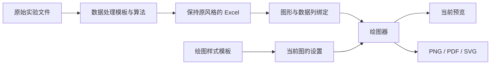

# 科研绘图项目设计学习报告

调研日期：2026-10-24。目标是 ec-lab 的“数据处理 / 一键绘图”双工作区：先自动生成常用图，再调整坐标轴、图例、颜色、字体和尺寸。本文中的“源码事实”来自实际下载并阅读的代码；“建议”是针对本项目作出的设计判断，不表示相关功能已经集成。

建议保留现有 Matplotlib 绘图与导出，重点学习 Veusz 的绘图对象和属性编辑、LabPlot 的模板与工作区设计。PyQtGraph 适合作为以后大数据交互预览的候选。这样可以继续使用已经认可的 Excel，不必为了换绘图软件重写数据处理。

## 1. 看了哪些项目，为什么选它们

| 项目 | 实际定位 | 最值得学习的部分 | 对 ec-lab 的判断 |
| --- | --- | --- | --- |
| [Veusz](https://github.com/veusz/veusz) | 科研绘图应用，以绘图组件组合图形 | 数据与图形分开保存；属性面板；默认样式；可撤销操作 | 本次最主要的设计参考。它使用 PyQt6，本项目使用 PySide6，不能把窗口代码直接粘贴进来就当成完成集成 |
| [LabPlot](https://github.com/KDE/labplot) | 完整的数据分析、表格和科研绘图应用；GitHub 是官方镜像，开发主仓在 KDE Invent | 项目树、中心画布、属性面板；曲线/轴/图例分别设置；模板和主题 | 交互形态接近用户期望。C++/Qt/KDE 依赖较多，本期参考交互与结构，不嵌入整套应用 |
| [PyQtGraph](https://github.com/pyqtgraph/pyqtgraph) | Python 科研图形与 GUI 库，不是完整的 Origin 式应用 | 参数树、缩放平移、显示数据优化、信号合并 | 可以研究局部复用，尤其参数编辑和大数据预览；不能装上后就自动获得完整科研排版工作台 |
| [SciDAVis](https://github.com/SciDAVis/scidavis) | 科研数据分析和绘图应用 | 表格选列出图、双击曲线/轴编辑、图层与模板 | 作为操作流程的补充参考。本次阅读官方 README 与其链接的手册，未下载/运行它的源码 |

项目定位分别核对了 [Veusz README](https://github.com/veusz/veusz/blob/d9401b33aeb608d2c2f9b504cd768b82547282ee/README.md)、[LabPlot README](https://github.com/KDE/labplot/blob/4d0e1675108717a1c78ced3bfa3e9f62795b3cb6/README.md)、[PyQtGraph README](https://github.com/pyqtgraph/pyqtgraph/blob/1c8b36369f59a65811ce49db6e1bbf949ab1d1a1/README.md)。SciDAVis 的[官方绘图教程](https://highperformancecoder.github.io/scidavis-handbook/using.html)适合学习操作概念；该手册标注基于 1.23，不能当作当前所有版本功能的保证。

## 2. 实际下载记录

存放位置：[本地研究目录](E:/测试/ec-lab/output/research_20261024)。下载的是三个项目的**选定源码文件**，不是完整仓库，也没有安装或执行这些第三方代码。Git 克隆和整包下载通道连接失败，随后通过官方 `raw.githubusercontent.com` 按固定提交下载关键文件。这样也避免了拉取 LabPlot 的大量历史、翻译、资源、子模块和编译依赖。

| 项目 | 固定提交 | 提交时间（UTC） | 下载文件数 | 文件字节数 |
| --- | --- | --- | ---: | ---: |
| Veusz | `d9401b33aeb608d2c2f9b504cd768b82547282ee` | 2026-08-22 09:04:10 | 22 | 555,637 |
| LabPlot | `4d0e1675108717a1c78ced3bfa3e9f62795b3cb6` | 2026-10-23 01:49:09 | 23 | 962,163 |
| PyQtGraph | `1c8b36369f59a65811ce49db6e1bbf949ab1d1a1` | 2026-10-22 12:03:34 | 16 | 361,583 |

合计 61 个文件、1,879,383 字节，约 1.79 MiB，不含旁置目录树和下载记录。每个文件均与 GitHub 固定提交目录树中的 Git blob SHA-1 一致，并另存 SHA-256。三个 `*-download.json` 保存逐文件来源、哈希和范围说明；三个 `*-tree.json` 保存对应提交完整目录树。以下源码链接全部固定到这次读取的提交，后续上游变动不会改变本文证据。

## 3. 成熟软件怎样把“能画图”变成“好用的绘图工具”

### 3.1 一份数据，可以对应多张外观不同的图

**源码事实。** Veusz 的 `Document` 分别维护数据字典 `data` 和绘图对象树 `basewidget`。XY 曲线设置中的 `xData`、`yData` 指向数据；线型、点型等是另一些设置。LabPlot 的 `XYCurve` 引用 X/Y 数据列，并用专门的命令改变引用。图形对象不等同于 Excel 表格本身。[Veusz 文档对象](https://github.com/veusz/veusz/blob/d9401b33aeb608d2c2f9b504cd768b82547282ee/veusz/document/doc.py#L124)、[Veusz XY 曲线](https://github.com/veusz/veusz/blob/d9401b33aeb608d2c2f9b504cd768b82547282ee/veusz/widgets/point.py#L351)、[LabPlot 曲线数据绑定](https://github.com/KDE/labplot/blob/4d0e1675108717a1c78ced3bfa3e9f62795b3cb6/src/backend/worksheet/plots/cartesian/XYCurve.cpp#L532)

**对本项目的建议。** 例如，同一份 CDI 处理结果，可以生成“电导率随时间”“每圈吸附容量”“每圈最大吸附量”三张图。修改第三张图的字体，只改第三张图的配置；不重算电导率，不修改 Excel，也不把其他两张图的字体一起改掉。只有用户明确选择“应用到全部图”时，才批量应用。

现有 [ec_plotting.py](E:/测试/ec-lab/ec_plotting.py) 已有 `TableBook`、`ColumnSeries`、`PlotSpec`：分别描述表格、数据列绑定、图形。这个基础可以继续使用，优先补足可编辑样式对象，无需把文件读取和绘图推倒重来。

此图是 ec-lab 的建议结构，不是对任一第三方源码的完整复刻。

### 3.2 属性面板只显示当前选中的对象

**源码事实。** Veusz 根据设置类型创建控件，再把控件变化连接回设置处理；设置本身与具体输入框分开。PyQtGraph 同样把纯参数 `Parameter`、参数显示项 `ParameterItem`、参数树控件 `ParameterTree` 分开。LabPlot 的主窗口把属性面板放在可滚动的堆叠容器中，为不同对象切换相应界面。[Veusz 属性控件生成](https://github.com/veusz/veusz/blob/d9401b33aeb608d2c2f9b504cd768b82547282ee/veusz/windows/treeeditwindow.py#L412)、[PyQtGraph 参数树文档](https://pyqtgraph.readthedocs.io/en/latest/api_reference/parametertree/index.html)、[LabPlot 主窗口](https://github.com/KDE/labplot/blob/4d0e1675108717a1c78ced3bfa3e9f62795b3cb6/src/frontend/MainWin.cpp#L615)

**对本项目的建议。** 一键绘图工作区先只有三个明确区域：左侧“图形列表”，中间大预览，右侧“绘图设置”。右侧按“坐标轴、曲线与颜色、图例、字体、图幅尺寸”分组，可以折叠。顶部“当前预览”负责切图；“正在调整：某张图”仅显示名称。避免两个下拉框同时控制当前图，造成用户不知道自己在改哪张。

常用设置先放出来：X/Y 标题、自动或手动范围、图例开关/位置、线条颜色/粗细、字体/字号、宽高。误差棒、双 Y 轴、多图拼版等后续再加，避免初次打开就出现几十项。

### 3.3 “绘图模板”与“本次画图记录”是两种文件

**源码事实。** LabPlot 的曲线模板保存线、符号、填充等样式；源码明确排除一般页中与样式无关的设置。模板加载被组合成一次可撤销操作。Veusz 把默认线宽、颜色和字体收进文档样式表。PyQtGraph 参数树支持保存/恢复状态，恢复时可合并信号，避免控件尚未填完就触发绘制。[LabPlot 模板读写](https://github.com/KDE/labplot/blob/4d0e1675108717a1c78ced3bfa3e9f62795b3cb6/src/frontend/dockwidgets/XYCurveDock.cpp#L678)、[Veusz 样式表](https://github.com/veusz/veusz/blob/d9401b33aeb608d2c2f9b504cd768b82547282ee/veusz/setting/stylesheet.py#L31)、[PyQtGraph 状态保存](https://github.com/pyqtgraph/pyqtgraph/blob/1c8b36369f59a65811ce49db6e1bbf949ab1d1a1/pyqtgraph/parametertree/Parameter.py#L463)

**对本项目的建议。** 明确三类保存内容：

| 类型 | 保存什么 | 使用场景 |
| --- | --- | --- |
| 数据处理模板 | 质量、50 mL 体积、采样间隔、分圈周期、标定参数、算法版本 | 下次同类实验继续按同一规则处理 |
| 绘图样式模板 | 字体、线宽、配色、图例、图幅尺寸、刻度外观 | 换一批实验数据，仍画成相同风格 |
| 本次绘图配方 | Excel 路径与哈希、工作表、X/Y 列、图形、最终样式、输出设置 | 回到这一次实验，复现这张图 |

样式模板默认不携带上一批实验路径、不改数据单位；手动轴范围可以保存，但加载到新数据时应明显标注“手动范围”，给“恢复自动范围”按钮。配方则应完整记录最终范围。界面浅色/深色属于软件外观，应与论文图的白色背景分开；切换深色模式不应悄悄把论文图导出成黑底。

模板建议继续用带版本号、字段校验的 JSON。Veusz 支持脚本式文档加载，相关加载器有执行及安全检查逻辑；这不意味着 ec-lab 需要开放执行 Python 的模板。本项目目前只需要声明“设置是什么”。[Veusz 加载器](https://github.com/veusz/veusz/blob/d9401b33aeb608d2c2f9b504cd768b82547282ee/veusz/document/loader.py#L92)

### 3.4 修改要能撤销，而且一次操作对应一次撤销

**源码事实。** Veusz 把一次改设置封装成操作，保存旧值、新值，分别实现执行和撤销；文档维护撤销/重做历史。LabPlot 用撤销栈，批量设置可组合成一个宏操作，其撤销栈还专门处理重入问题。[Veusz 设置操作](https://github.com/veusz/veusz/blob/d9401b33aeb608d2c2f9b504cd768b82547282ee/veusz/document/operations.py#L60)、[Veusz 历史管理](https://github.com/veusz/veusz/blob/d9401b33aeb608d2c2f9b504cd768b82547282ee/veusz/document/doc.py#L197)、[LabPlot 撤销栈](https://github.com/KDE/labplot/blob/4d0e1675108717a1c78ced3bfa3e9f62795b3cb6/src/backend/lib/UndoStack.h)

**对本项目的建议。** 第一版可只记录当前图配置的前后状态，先支持“撤销”“重做”“恢复模板”。不必复制完整科学绘图软件的命令系统。应用一套模板可能改变十几个字段，应只产生一条历史。切换图形或把配置填回输入框不应新增历史，也不应让每一个控件各触发一次重绘。

### 3.5 预览响应快，靠少做重复工作

**源码事实。** Veusz 使用文档变化编号、缩放和页码判断是否需要重绘；渲染队列跳过被较新任务替代的任务，避免旧图覆盖较新的请求。PyQtGraph 的 `SignalProxy` 把密集信号合并或限速。其曲线对象也提供降采样和可视范围裁剪。[Veusz 变化检查](https://github.com/veusz/veusz/blob/d9401b33aeb608d2c2f9b504cd768b82547282ee/veusz/windows/plotwindow.py#L1053)、[Veusz 渲染队列](https://github.com/veusz/veusz/blob/d9401b33aeb608d2c2f9b504cd768b82547282ee/veusz/windows/plotwindow.py#L117)、[PyQtGraph 信号合并](https://github.com/pyqtgraph/pyqtgraph/blob/1c8b36369f59a65811ce49db6e1bbf949ab1d1a1/pyqtgraph/SignalProxy.py#L11)

**对本项目的建议。** 读取数据只做一次；改字体、颜色不用重新读取整本 Excel。输入停止约 200～300 ms 后合并更新预览；开始导出前先应用最后一次尚未刷新到画布的修改。预览只缓存当前图，批量导出串行处理，每张完成后释放 Figure。实际是否需要更多线程，要由测得的耗时决定。

注意一个电化学数据特有问题：PyQtGraph 的 `clipToView` 要求 X 数据升序，而 CV 电位通常往返扫描。不能直接打开此优化，也不能为了速度把电位排序。降采样只是显示策略，不能成为计算吸附量、积分或最终数据导出的输入。[PyQtGraph 裁剪前提](https://github.com/pyqtgraph/pyqtgraph/blob/1c8b36369f59a65811ce49db6e1bbf949ab1d1a1/pyqtgraph/graphicsItems/PlotDataItem.py#L1071)、[降采样实现说明](https://github.com/pyqtgraph/pyqtgraph/blob/1c8b36369f59a65811ce49db6e1bbf949ab1d1a1/pyqtgraph/graphicsItems/PlotDataItem.py#L1024)

“点击电导率处理按钮后卡一会”还需要区分发生在打开窗口、扫描文件、读取 Excel 还是开始处理。建议让窗口先出现，再用单个后台任务准备耗时数据，显示状态并防止重复点击。不能只把整个窗口构造挪进线程：Qt 窗口仍在界面线程，Matplotlib 绘制也必须安排串行访问。官方明确说明 Matplotlib 不是线程安全的，GUI 后端通常要求主线程。[Matplotlib 线程说明](https://matplotlib.org/stable/users/faq.html#work-with-threads)

### 3.6 导出应独立于屏幕截图

**源码事实。** LabPlot 的导出接口接收格式、范围、背景、分辨率，分别使用 PDF、SVG、位图路径绘制。PyQtGraph 把导出器独立成类，位图导出参数包括宽高、背景和抗锯齿。Veusz 也有单独的位图、PDF、SVG 导出任务。[LabPlot 导出](https://github.com/KDE/labplot/blob/4d0e1675108717a1c78ced3bfa3e9f62795b3cb6/src/frontend/worksheet/WorksheetView.cpp#L2052)、[PyQtGraph 位图导出器](https://github.com/pyqtgraph/pyqtgraph/blob/1c8b36369f59a65811ce49db6e1bbf949ab1d1a1/pyqtgraph/exporters/ImageExporter.py#L12)、[Veusz 导出模块](https://github.com/veusz/veusz/blob/d9401b33aeb608d2c2f9b504cd768b82547282ee/veusz/document/export.py)

**对本项目的建议。** 图幅优先显示 cm 或 mm，字号用 pt，PNG 再配 DPI；PDF/SVG 保留矢量内容。导出用同一份最终配置与完整数据重新绘制。继续保留用户要求的选图、全选/全不选、逐图命名、输出位置、取消，以及完成后询问是否打开文件夹。

一个容易理解的例子：8 cm 宽的图在 600 dpi 下约为 1,890 像素宽。预览窗口的宽度与这张论文图的物理尺寸不是一回事。缩小程序窗口不应改变导出图的字号和物理尺寸。

## 4. 已选定的 UI 与本轮落地情况

用户已经选定“数据处理 / 一键绘图”双工作区，并选择以文件清单组织数据处理页面。本轮已按这个方向实现；下面的菜单和工作区说明用于解释设计，未将撤销或自动合并预览列为现成功能。

顶部已有五个菜单：**文件、处理、绘图、外观、帮助**。下方是“数据处理 / 一键绘图”两个工作区标签。菜单提供完整操作，工作区保留最常用的按钮；切换标签复用已有页面。

| 菜单 | 本轮内容 | 说明 |
| --- | --- | --- |
| 文件 | 添加文件夹、输出位置、结果文件夹 | “输出位置”负责设置，“结果文件夹”打开最近成功结果；打开 Excel 入口位于绘图工作区 |
| 处理 | 加载数据处理模板、保存数据处理模板、修改数据处理模板 | 模板名称与关键参数摘要放在数据工作区，不需要同时打开多个参数窗口 |
| 绘图 | 绘图模板 → 加载模板、编辑模板；绘图设置；调色盘 | 设置面板中提供保存样式模板 |
| 外观 | 浅色模式、深色模式 | 仅影响应用外观；论文画布默认白底 |
| 帮助 | 使用说明、科研绘图设计学习报告、高级电化学工具、错误日志、关于 | 原比电容、EIS 和详细预览入口保留在高级工具中 |

数据处理工作区采用文件清单，配合处理方式、参数摘要、日志和“开始处理”。CDI 默认体积为 50 mL，参数可以展开修改。处理完成后可把所选结果直接传入另一工作区，不要求用户重新寻找刚输出的文件。

一键绘图工作区已有常用图列表、上方“当前预览”、大预览画布及可展开的设置面板。“正在调的图”只读显示；输出入口连接选图、命名、格式和保存位置弹窗。设置包含坐标范围、图例、逐曲线名称和颜色、字体字号、图幅尺寸及 DPI。

配色入口提供色板预览和单条曲线颜色。图例、轴标题和曲线名称的编辑只改图中显示文字；源表列名仍保留。

## 5. 当前实施状态与尚未完成的部分

| 内容 | 状态 | 本轮范围 |
| --- | --- | --- |
| 文件清单与双工作区 | 已实现 | 数据处理和一键绘图在同一主窗口切换，五个菜单已整理；保留高级工具入口 |
| 数据处理与绘图分离 | 已实现 | 绘图读取处理后的 Excel，不重新计算实验数值；CDI 与用户参考样本的一致性属于数据处理验收，不由本设计调研替代 |
| 每张图的独立样式 | 已实现 | `PlotSpec.style` 保存坐标范围、图例、逐曲线标签/颜色、配色、字体、尺寸、线宽和 DPI；预览与导出共用参数 |
| 样式模板 | 已实现 | 带版本号的 JSON；可保存/加载纯外观，拒绝路径和数据列字段；无效范围、未知版本给出明确错误 |
| 本次绘图配方 | 已实现并兼容旧版 | 新配方保存最终完整样式，旧 v1 配方缺少 style 时仍使用原预设；读取时核对源文件哈希 |
| 配置撤销/重做 | 尚未实现 | 上文的命令与历史栈是学习所得的建议，目前不能把它当作已有按钮或功能 |
| 自动合并预览更新 | 尚未实现 | 当前仍有明确的“更新预览”操作；上文所述 200～300 ms 合并更新与新旧任务控制尚未落地 |
| Veusz / LabPlot / PyQtGraph 集成 | 未集成 | 已下载阅读选定源码；当前绘图和导出继续使用 Matplotlib，没有增加第二绘图后端 |

当前实现见 [ec_workspaces.py](E:/测试/ec-lab/ec_workspaces.py)、[ec_plotting.py](E:/测试/ec-lab/ec_plotting.py) 与 [ec_plot_studio.py](E:/测试/ec-lab/ec_plot_studio.py)。样式后端定向测试覆盖了原始采样顺序和断点、样式参数校验、旧配方兼容、自定义 DPI，以及导出后按配方重放图片的像素一致性。具体界面和发布包的整体验收应以本轮测试记录为准。

本轮范围是用户选定的常用图自动生成与外观调整。报告中的第三方设计分析不代表已安排完整 Origin 功能、外部应用适配或其他新功能。

## 6. 许可与可复用范围

| 项目 | 本次核实的许可事实 | 本项目应怎样处理 |
| --- | --- | --- |
| Veusz | README 和代码头声明 GPL v2 或更高版本；源码包有 COPYING | 当前仅学习结构。若以后复制/修改/随软件分发其代码，需要核对相应许可与源码提供义务，不能删去声明当成自有代码 |
| LabPlot | 本次读取的核心与界面文件为 `GPL-2.0-or-later`；仓库同时有多种依赖许可 | 逐文件、逐依赖检查。不能用 GitHub 顶部一个标签概括整个发行包 |
| PyQtGraph | 主项目 LICENSE.txt 为 MIT；仓库中另有 CET 色图数据的 CC-BY 许可文件 | 如果复用主项目代码，保留其版权和许可文本；色图、示例资源单独核对 |
| SciDAVis | 官方 README 声明 GPL v2 或更高版本 | 当前仅阅读文档作流程参考，不复制其 UI/算法代码 |

许可来源：[Veusz README](https://github.com/veusz/veusz/blob/d9401b33aeb608d2c2f9b504cd768b82547282ee/README.md)、[LabPlot 文件头示例](https://github.com/KDE/labplot/blob/4d0e1675108717a1c78ced3bfa3e9f62795b3cb6/src/frontend/TemplateHandler.cpp)、[PyQtGraph MIT 文本](https://github.com/pyqtgraph/pyqtgraph/blob/1c8b36369f59a65811ce49db6e1bbf949ab1d1a1/LICENSE.txt)、[PyQtGraph CET 色图许可](https://github.com/pyqtgraph/pyqtgraph/blob/1c8b36369f59a65811ce49db6e1bbf949ab1d1a1/pyqtgraph/colors/maps/CC-BY%20license%20-%20applies%20to%20CET%20color%20map%20data.txt)、[SciDAVis README](https://github.com/SciDAVis/scidavis#license)。这是本次源码声明的记录，尚未作未来某种具体集成方式的许可结论。

技术上也需要分开判断：Veusz 的安装说明要求 PyQt6；LabPlot 当前源码已有可选 C++/Python SDK 构建选项，并提到 PySide6/Shiboken6，不能因此推断本机 PySide6 便携包可以直接加载它。还需验证编译产物、ABI、依赖、接口和分发方式。本次没有构建或验证这些 SDK。[Veusz 安装说明](https://github.com/veusz/veusz/blob/d9401b33aeb608d2c2f9b504cd768b82547282ee/INSTALL.md)、[LabPlot 构建说明](https://github.com/KDE/labplot/blob/4d0e1675108717a1c78ced3bfa3e9f62795b3cb6/INSTALL)

## 7. 建议怎样学习这些代码

先看 Veusz 的 `veusz/document/doc.py` 与 `veusz/widgets/point.py`，理解“数据保存在哪里、曲线引用什么”。再看 `veusz/windows/treeeditwindow.py`，理解用户改一个输入框怎样改变图形；随后看 `veusz/document/operations.py`，理解为什么撤销只需保存设置前后值。

接着看 LabPlot 的 `src/frontend/dockwidgets/XYCurveDock.cpp` 中模板读写部分，理解外观模板为什么不应该携带实验数据路径；看 `src/frontend/MainWin.cpp` 中项目树、中心内容、属性面板的分区。最后看 PyQtGraph 的 `pyqtgraph/SignalProxy.py`，理解为什么拖动滑块时不能每个细小变化都完整重绘。

读这些文件时可始终带着同一个例子：**把 CDI 吸附容量图的蓝线改成橙线，字号从 10 改成 12，保存成模板，再换一份 Excel。** 能清楚说出哪些数据不变、哪些设置变化、如何撤销、怎样导出，就理解了这个项目现阶段最需要的绘图系统设计。
